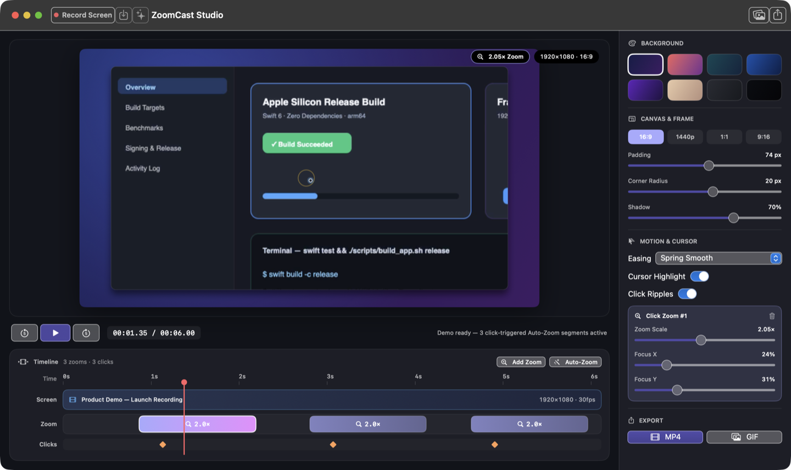

# ZoomCast

**Open-source Screen Studio alternative for macOS.** Native Swift 6 screen recorder and auto-zoom demo editor built with `ScreenCaptureKit`, `AVFoundation`, and `CoreGraphics` — zero Electron, zero external Swift packages, 2.7 MB signed `.app`.



## Why ZoomCast

Tools like [Screen Studio](https://www.screen.studio/) proved how much better product demos look with automatic click-triggered zoom, smooth camera easing, and studio framing — but they are closed-source and cost \$89–\$229. ZoomCast brings the core studio workflow to macOS as a small, local, MIT-licensed Swift 6 app.

## Features

- **Native Screen & Click Capture (`ScreenCaptureKit`):** Records displays via `SCStream` + hardware H.264 `AVAssetWriter` while sampling cursor coordinates and left-click events in lockstep.
- **Click-Triggered Auto-Zoom Engine:** Automatically clusters nearby clicks into non-overlapping `ZoomSegment`s with quintic `Spring Smooth`, `Snappy`, or `Gentle` camera easing and bounds-clamped crops.
- **Studio Framing & Compositing:** 8 curated macOS-style gradient backgrounds, configurable padding (`0–140 px`), corner radius (`0–36 px`), soft drop shadow, aspect presets (`16:9 1080p`, `1440p`, `1:1`, `9:16`), optional cursor highlight, and click ripple rings.
- **Multi-Track Studio Timeline:** Scrubbing playhead, screen track, clickable/editable zoom blocks (`Scale`, `Focus X/Y`, `+ Add Zoom`, `Auto-Zoom`), and orange click markers.
- **MP4 & Web GIF Export:** Hardware-accelerated H.264 `.mp4` export and 15 fps web-ready animated `.gif` export (ideal for GitHub READMEs).
- **Safe Demo Recording on First Launch:** Generates a local 6-second 1080p demo recording with 3 click-triggered zoom blocks so you can test the editor and exports immediately without granting Screen Recording permissions first.

## Install

### Prebuilt Binary (Apple Silicon, macOS 14+)

1. Download `ZoomCast-v1.0.0-macOS-arm64.zip` from [Releases](https://github.com/zm57cdj9yb-beep/zoomcast/releases/latest).
2. Unzip and move `ZoomCast.app` to `/Applications`.
3. Because releases are currently ad-hoc signed (not Apple-notarized), clear the quarantine flag once on first launch:
   ```bash
   xattr -cr /Applications/ZoomCast.app
   ```

### Build from Source

Requires macOS 14+ and Xcode 16+ (Swift 6):

```bash
git clone https://github.com/zm57cdj9yb-beep/zoomcast.git
cd zoomcast
swift test
./scripts/build_app.sh release
open build/ZoomCast.app
```

## Benchmarks (Apple M2, 8 GB RAM)

Reproducible via [`./benchmarks/run_benchmarks.sh`](benchmarks/run_benchmarks.sh) (full details in [`benchmarks/RESULTS.md`](benchmarks/RESULTS.md)):

| Workload | Result | Throughput |
|---|---|---:|
| 10,000 Spring Camera evaluations | `6.54 ms` | ~1.53M evals/s |
| 180-frame `1920×1080` Auto-Zoom MP4 export (6 s @ 30 fps) | `5.66 s` (`2.56 MB`) | **`31.8 fps`** (>1× real-time) |
| 90-frame `960×540` Web GIF export (6 s @ 15 fps) | `2.96 s` (`1.11 MB`) | **`30.4 fps`** (2× real-time) |
| Signed `.app` bundle size | **`2.7 MB`** | Zero external dependencies |

## Comparison

| Tool | License / Price | Auto-Zoom on Clicks | Studio Backgrounds & Shadow | GIF Export | Engine |
|---|---|---|---|---|---|
| **ZoomCast** | **MIT (Free)** | Yes | Yes | Yes | Native Swift 6 (`2.7 MB`) |
| Screen Studio | Commercial (\$89–\$229) | Yes | Yes | Yes | Electron + Native |
| OBS Studio | GPL-2.0 (Free) | No (manual plugins) | Manual scenes | No | C/C++ |
| Kap | MIT (Free) | No | No | Yes | Electron |

### When another tool is a better fit
- **Screen Studio** if you need webcam PiP, microphone/system audio mixing, custom cursor packs, or vertical auto-reframe out of the box.
- **OBS Studio** if you are livestreaming or need multi-source scenes and audio routing.

## Current Limitations

- **Video-only capture in `v1.0.0`:** Microphone and system audio tracks are not mixed into recordings yet.
- **Ad-hoc code signing:** Not notarized with an Apple Developer ID yet (`xattr -cr` needed for downloaded zips).
- **Display capture:** `v1.0.0` captures full displays via `ScreenCaptureKit` (or imports any existing `.mp4`/`.mov`); single-window and region pickers are planned next.

## License

MIT — see [LICENSE](LICENSE).
